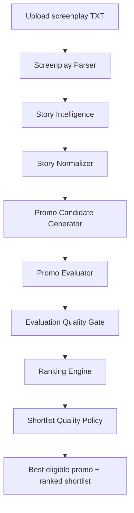

<div align="center">

# PromoPilot 🎬

### From screenplay to the strongest promo moment.

Upload a timestamped microdrama screenplay. PromoPilot analyses the story, finds possible promo clips, checks their quality and ranks the strongest options — with the best eligible promo shown first.

<p>
  <a href="https://promopilot-9x5ece5swsgxpf5ryewgnx.streamlit.app/"></a>
  <a href="https://github.com/4NShulr4j/PromoPilot"></a>
</p>


</div>

---

## The idea

Finding a good promo moment is not just about picking a dramatic line. The moment needs to make sense on its own, create curiosity, carry an emotional beat and end at a useful point.

**PromoPilot helps with that search.** It takes a timestamped screenplay (`.txt`), works through the episode and turns possible story moments into an evaluated, ranked promo shortlist. Instead of manually scanning every scene, a reviewer gets a focused set of options with the evidence and timing needed to make an editorial decision.

> **What the app delivers:** ranked promo recommendations, not finished video files. PromoPilot identifies the suggested clip and provides its timestamps and supporting details; the final video still needs to be assembled in a video editor.

## At a glance

| | |
|---|---|
| **Input** | Timestamped microdrama screenplay files (`.txt`) |
| **Processing** | Story analysis, candidate generation, AI evaluation and deterministic quality checks |
| **Main result** | The highest-ranked promo that clears the shortlist rules |
| **Also included** | Other shortlisted clips, full ranking, scores, timestamps and review flags |
| **Interface** | Streamlit web application |
| **AI provider** | Groq API |

## How it works

Upload the screenplay, choose a show ID and start the run. PromoPilot takes care of the processing stages and brings the results together in the app.



### The stages behind the result

| Stage | What it does |
|---|---|
| **1. Screenplay Parser** | Reads the screenplay and extracts scenes, timestamped events, dialogue and directions. |
| **2. Story Intelligence** | Uses an LLM to identify characters, relationships, conflicts and dramatic moments. |
| **3. Story Normalizer** | Helps reconcile different speaker labels for the same character and maintains a show-level character registry. |
| **4. Candidate Generator** | Builds possible promo clips from source events and their timestamps. |
| **5. Promo Evaluator** | Uses an LLM to assess the creative strength and watchability of each candidate. |
| **6. Evaluation Quality Gate** | Applies source-based checks for hook timing, dialogue continuity and events immediately after a proposed cut. |
| **7. Ranking Engine** | Uses adjusted scores, blocks confirmed mid-thought cuts and groups overlapping candidates. |
| **8. Shortlist Quality Policy** | Applies the minimum-score rule and prepares the final recommendations. |

Story understanding and creative evaluation use Groq. Parsing, normalization, candidate construction, quality checks and ranking are handled by the Python code.

## What makes a promo score well?

The evaluator scores each candidate across six dimensions. The weighted score is calculated using these priorities:

| Evaluation dimension | Weight |
|---|---:|
| Hook strength | 25% |
| Cliffhanger strength | 25% |
| Standalone clarity | 20% |
| Emotional engagement | 15% |
| Pacing | 10% |
| Clip integrity | 5% |

The score is only one part of the decision. The quality gate checks the candidate against the source screenplay. For example, if the same speaker clearly continues a sentence just after the proposed ending, the candidate is flagged as a mid-thought cut and receives the configured score adjustment. The original model score is retained for comparison.

The ranking stage uses the adjusted score — it does not apply the same penalty twice. It also reduces repetition by grouping highly overlapping clips. Review flags, such as a question that is quickly followed by another event, are surfaced for human review rather than automatically treated as proof that a promo is bad.

The shortlist policy uses a configurable minimum score (currently **40/100**) and a maximum shortlist size (currently **5**). A candidate below the threshold should not be presented as an approved recommendation just to fill the list.

## What you get

The results screen puts the **best-ranked eligible promo** first, with its score and the details needed to review the proposed clip.

- **Best promo:** top eligible recommendation, rank and score.
- **Clip details:** start time, end time and duration.
- **Story evidence:** hook, ending and relevant source dialogue where available.
- **Editorial notes:** quality flags and reasons a candidate may need attention.
- **Other options:** the remaining shortlist and the full candidate ranking.
- **Downloads:** best-promo brief, JSON reports and ranking exports, depending on the selected download option in the app.

A recommendation is not final editorial approval. Review the source context and flagged moments before using a clip.

## Built with

| Tool | Role in the project |
|---|---|
| **Python** | Main processing logic and pipeline orchestration |
| **Streamlit** | Web interface and interactive results |
| **Groq** | LLM API for story analysis and promo evaluation |
| **`openai/gpt-oss-20b`** | Default model configured for Groq; can be changed with `GROQ_MODEL` |
| **Pydantic** | Structured data validation |
| **Pandas** | Tabular data handling and exports |
| **python-dotenv** | Local environment configuration |
| **pytest** | Automated tests |

The project is designed to use free and open-source tools where possible. Groq model availability, quotas and rate limits depend on the account and can change. Streamlit Community Cloud also has resource and usage limits.

## Project structure

```text
PromoPilot/
├── app.py                         # Streamlit application
├── main.py                        # Command-line entry point
├── requirements.txt                # Project dependencies
├── requirements-streamlit.txt      # Streamlit dependencies
├── .streamlit/
│   └── config.toml                 # Streamlit configuration
├── docs/                           # Design and implementation notes
├── prompts/                        # Prompts used by the LLM stages
├── src/
│   ├── parser.py
│   ├── llm_client.py
│   ├── story_analyzer.py
│   ├── story_normalizer.py
│   ├── candidate_generator.py
│   ├── promo_evaluator.py
│   ├── evaluation_quality_gate.py
│   ├── ranking_engine.py
│   ├── shortlist_quality_policy.py
│   ├── pipeline_runner.py
│   └── ui_helpers.py
└── tests/                          # Automated tests
```

## Run PromoPilot locally

### 1. Get the code

```bash
git clone https://github.com/4NShulr4j/PromoPilot.git
cd PromoPilot
```

If the repository is private, sign in to GitHub with an account that has access to it.

### 2. Create and activate a virtual environment

**Linux / macOS**

```bash
python3 -m venv .venv
source .venv/bin/activate
```

**Windows PowerShell**

```powershell
py -m venv .venv
.venv\Scripts\Activate.ps1
```

### 3. Install dependencies

```bash
python -m pip install --upgrade pip
pip install -r requirements.txt
```

### 4. Configure Groq

Create a `.env` file in the project root:

```dotenv
GROQ_API_KEY=your_groq_api_key
GROQ_MODEL=openai/gpt-oss-20b
GROQ_REASONING_EFFORT=low
```

Replace the placeholder with your own API key. Keep `.env` local — it must never be committed to GitHub. The model and reasoning-effort values can be changed through environment variables if you use a different supported model.

### 5. Start the app

```bash
streamlit run app.py
```

Open the local URL printed in your terminal. Upload a screenplay in the supported timestamped TXT format, provide a show ID and start promo generation.

## Using the live app

You can use PromoPilot directly without setting up a local Python environment:

**[Open the live PromoPilot app](https://promopilot-9x5ece5swsgxpf5ryewgnx.streamlit.app/)**

A typical run looks like this:

1. Upload one or more screenplay `.txt` files.
2. Enter a show / series ID. Reuse the same ID for episodes from the same show so the character registry can be reused; use a different ID for another show.
3. Review the available processing settings, if needed.
4. Select **Generate Promos** and follow the progress shown in the app.
5. Review the best promo, the other shortlisted candidates and any editorial flags.
6. Download the reports you need.

For multiple uploads, each file should resolve to a distinct episode ID. Avoid uploading two files that resolve to the same episode ID in one batch. Screenplays should be UTF-8 text and follow the event/timestamp structure supported by the parser.

## Run the tests

From the project root, with the virtual environment activated:

```bash
python -m pytest -q tests
```

To run a specific test module:

```bash
python -m pytest -q tests/test_parser.py
```

## Deployment

The live application is hosted on **Streamlit Community Cloud** and connected to the GitHub repository.

- **Live app:** [promopilot-9x5ece5swsgxpf5ryewgnx.streamlit.app](https://promopilot-9x5ece5swsgxpf5ryewgnx.streamlit.app/)
- **Repository:** [4NShulr4j/PromoPilot](https://github.com/4NShulr4j/PromoPilot)

For a separate deployment, connect the repository to Streamlit Community Cloud, select the `main` branch and `app.py`, then add the required secrets in the app settings. A typical secrets configuration is:

```toml
GROQ_API_KEY = "your_groq_api_key"
GROQ_MODEL = "openai/gpt-oss-20b"
GROQ_REASONING_EFFORT = "low"
```

Do not place real credentials in this README, source code or GitHub commits.

## Privacy and things to keep in mind

- **Screenplay content is sent to Groq** for the AI-powered story analysis and evaluation stages. Only upload scripts you are allowed to process, and check the provider's current data-handling terms before using confidential material.
- **Keep secrets out of Git.** Store the API key in a local `.env` file or Streamlit Community Cloud Secrets. Never commit it or include it in screenshots.
- **Treat generated reports as sensitive.** Reports can contain dialogue excerpts and other information derived from the screenplay.
- **Usage is not unlimited.** Groq quotas, rate limits and model availability, as well as Streamlit hosting limits, depend on current provider terms.
- **Human review still matters.** AI scores are decision-support signals. Check the full scene context and editorial flags before approving a promo.
- **No MP4 rendering.** PromoPilot identifies and ranks potential clips; it does not currently edit the episode or export a finished video.

---

<div align="center">

**PromoPilot**  
*Find the moment. Check the cut. Put the strongest promo first.*

[Live application](https://promopilot-9x5ece5swsgxpf5ryewgnx.streamlit.app/) · [GitHub repository](https://github.com/4NShulr4j/PromoPilot)

</div>
